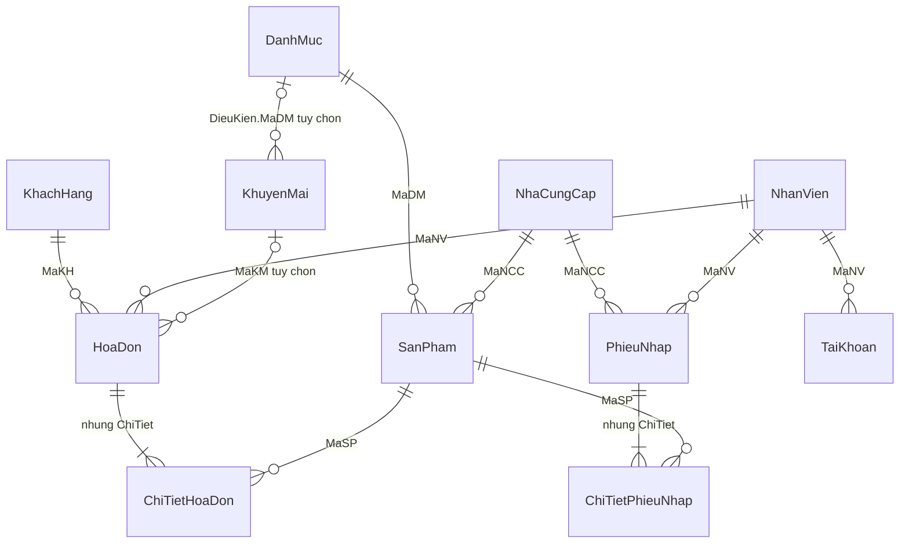

# ĐẶC TẢ YÊU CẦU PHẦN MỀM (SRS)

## Lịch sử thay đổi

| Phiên bản | Ngày | Nội dung |
|---|---|---|
| 1.0 | 15/11/2026 | Tổng hợp yêu cầu, phân tích dữ liệu, API, giao diện, wireframe và tiêu chí nghiệm thu. Người dùng đã duyệt. |
| 1.1 (bản nháp trước hiệu chỉnh) | 15/11/2026 | Đối chiếu giờ lưu trong file `02`; chốt môi trường/phiên bản thư viện; quy định `node:test`, unit test thuần và kiểm thử API trên DB thật chỉ đọc. Quy tắc cộng thêm ngày Việt Nam trong bản nháp không được người dùng xác nhận và đã được thay thế bởi hiệu chỉnh bên dưới. |
| 1.1 (hiệu chỉnh, chờ duyệt) | 15/11/2026 | So sánh trực tiếp khoảng thời điểm BSON bao gồm cả hai đầu; riêng `NgayKetThuc` hiển thị ngày UTC; đồng bộ BR-11, FR-10, AT-06, AT-12 và ca biên UTC. Bổ sung dotenv `quiet: true`, kiểm tra `db.version()` và tương thích driver 7.5.0 ở Đợt 1 trước API test. Chỉ sửa SRS, dừng chờ xác nhận trước Đợt 1. |

## 1. Thông tin tài liệu

| Thuộc tính | Nội dung |
|---|---|
| Tên hệ thống | Ứng dụng web minh họa quản lý siêu thị mini |
| Project | `QLSieuThiMini_Studio3T` |
| Database | `QLSieuThiMini` |
| Phiên bản tài liệu | 1.1 |
| Ngày lập | 15/11/2026 |
| Ngôn ngữ giao diện | Tiếng Việt |
| Phạm vi phiên bản | Bản 1, chỉ đọc dữ liệu |
| Trạng thái | SRS v1.0 đã duyệt; v1.1 đã hiệu chỉnh theo phản hồi, chưa được duyệt; chưa viết code, chờ xác nhận trước Đợt 1 |

Tài liệu tổng hợp yêu cầu người dùng, kết quả phân tích giai đoạn 1 và thiết kế Bước 1 của giai đoạn 2. Người dùng đã duyệt báo cáo giai đoạn 1 và SRS v1.0, cho phép xây dựng theo từng đợt. Tại lần cập nhật v1.1 này chỉ thực hiện mục A, dừng chờ xác nhận trước Đợt 1 và tiếp tục dừng sau mỗi đợt để người dùng kiểm tra.

Bản v1.1 hiện tại thay thế cách diễn giải ngày kết thúc trong bản nháp trước đó. Người dùng chưa xác nhận v1.1; không bắt đầu Đợt 1 cho đến khi nhận được xác nhận mới.

`SRS.md` được đặt tại thư mục gốc theo yêu cầu bổ sung của người dùng. Toàn bộ mã nguồn, cấu hình, hướng dẫn và kiểm thử của ứng dụng khi triển khai phải nằm trong `webapp/`.

## 2. Mục tiêu và phạm vi

### 2.1. Mục tiêu

- Xây dựng ứng dụng web minh họa việc khai thác MongoDB bằng driver chính thức, truy vấn tìm kiếm và Aggregation Framework.
- Hiển thị dữ liệu sản phẩm, bán hàng, nhập hàng, khách hàng, nhân viên và khuyến mãi.
- Cung cấp dashboard, báo cáo kinh doanh, cảnh báo kho và kiểm tra chất lượng dữ liệu.
- Giữ nguyên database hiện có; không tự sửa các sai lệch được phát hiện.
- Hỗ trợ trình bày đề tài về Studio 3T và cơ sở dữ liệu tài liệu quản lý siêu thị mini.

### 2.2. Người sử dụng và môi trường

| Thành phần | Mô tả |
|---|---|
| Người sử dụng | Sinh viên, giảng viên hoặc người xem bản minh họa |
| Quyền sử dụng | Xem, tìm kiếm, lọc, phân trang, xem chi tiết và báo cáo |
| Trình duyệt | Trình duyệt hiện đại có JavaScript, ES modules và canvas |
| Backend | Chạy trên máy có thể kết nối MongoDB local |
| MongoDB | Đã có database và dữ liệu mẫu được chuẩn bị trước |
| Studio 3T | Công cụ quản trị, đối chiếu dữ liệu; không cần mở liên tục khi ứng dụng chạy |
| Kết nối Internet | Cần để tải Chart.js từ CDN; nếu CDN lỗi, bảng số liệu và tra cứu vẫn hoạt động |

### 2.3. Chức năng trong phạm vi

1. Dashboard tổng quan.
2. Tra cứu và xem chi tiết sản phẩm.
3. Tra cứu và xem chi tiết hóa đơn.
4. Tra cứu và xem chi tiết phiếu nhập.
5. Tra cứu khách hàng, điểm tích lũy, lịch sử mua và top chi tiêu.
6. Danh sách nhân viên và thống kê doanh thu/số hóa đơn.
7. Danh sách khuyến mãi, điều kiện, trạng thái tính theo thời gian.
8. Báo cáo doanh thu, sản phẩm, khách hàng, thanh toán và nhập hàng.
9. Cảnh báo tồn kho và hạn sử dụng.
10. Kiểm tra tổng tiền, hiệu lực khuyến mãi và tham chiếu bị thiếu.

### 2.4. Ngoài phạm vi

- Tạo hóa đơn, tạo phiếu nhập hoặc tạo dữ liệu khác.
- Thêm, sửa, xóa, drop collection/database hoặc thay đổi index/validator.
- Tự chạy lại các file `01–07`.
- Đăng nhập, phân quyền, quản trị tài khoản hoặc hiển thị mật khẩu.
- Đồng bộ tồn kho, tự tính điểm, tự áp dụng giảm giá hoặc tự sửa dữ liệu lỗi.
- Quản lý lô hàng, trả hàng, hủy giao dịch, tính giá vốn hoặc lợi nhuận.
- Tự thực hiện import/export hoặc backup/restore qua ứng dụng.
- Triển khai hosting; bản 1 chạy local tại `http://localhost:3000`.

## 3. Ràng buộc công nghệ và bảo toàn project

| Mã | Yêu cầu bắt buộc |
|---|---|
| TC-01 | Backend sử dụng Node.js tối thiểu `20.19.0`, Express `5.2.1`, package `mongodb` chính thức `7.5.0` và dotenv `17.2.3`; môi trường triển khai/kiểm thử chuẩn hiện tại là Node `24.16.0`, npm `11.13.0`. |
| TC-02 | Frontend sử dụng HTML, CSS, JavaScript thuần; không framework, không bước build. |
| TC-03 | Biểu đồ sử dụng Chart.js `4.5.1`, CDN pin cố định `https://cdn.jsdelivr.net/npm/chart.js@4.5.1/dist/chart.umd.min.js`. |
| TC-04 | Đọc `MONGO_URI`, `DB_NAME` từ `.env`; không hard-code chuỗi kết nối trong code. |
| TC-05 | Có `.env.example` và hướng dẫn tạo `.env`; không đưa `.env` vào Git hoặc tài nguyên tĩnh. |
| TC-06 | Toàn bộ thành phần triển khai ứng dụng nằm trong thư mục con `webapp/`. |
| TC-07 | Không sửa, xóa, đổi tên các file `01–09` và `README.md` hiện có. |
| TC-08 | Chỉ dùng `find`, `aggregate`, `countDocuments` để khai thác dữ liệu. |
| TC-09 | Mọi API nghiệp vụ là GET; method khác GET trên `/api` bị từ chối. |
| TC-10 | Không đưa field `MatKhau` vào bất kỳ phản hồi API hoặc giao diện nào. |

Các biến cấu hình dự kiến:

| Biến | Giá trị trong `.env.example` | Ghi chú |
|---|---|---|
| `MONGO_URI` | `mongodb://localhost:27017` | Bắt buộc |
| `DB_NAME` | `QLSieuThiMini` | Bắt buộc |
| `PORT` | `3000` | Cổng ứng dụng |

Thiếu biến bắt buộc phải có thông báo cấu hình rõ ràng. Không tự chuyển sang database khác hoặc URI mặc định trong code.

### 3.1. Môi trường và phiên bản đã chốt

Đã chạy thực tế `node -v` và `npm -v` ngày 15/11/2026, kết quả lần lượt là `v24.16.0` và `11.13.0`. Chưa chạy `npm install` hoặc cài đặt ứng dụng trong bước cập nhật tài liệu.

| Thành phần | Phiên bản chốt | Ngày xuất bản trên npm (UTC) | Điều kiện Node theo metadata |
|---|---|---|---|
| Node.js | Tối thiểu `20.19.0`; môi trường chuẩn `24.16.0` đã có trên máy | Không áp dụng | Giữ môi trường Node 24 hiện có để triển khai và kiểm thử |
| npm | `11.13.0` đã có trên máy | 22/04/2026 | `^20.17.0` hoặc `>=22.9.0`; Node 24.16.0 đáp ứng |
| Express | `5.2.1` | 01/12/2025 | `>=18` |
| mongodb driver | `7.5.0` | 07/07/2026 | `>=20.19.0` |
| dotenv | `17.2.3` | 29/09/2025 | `>=12` |
| Chart.js qua CDN | `4.5.1` | 13/10/2025 | Không cần Node khi tải bản UMD trong trình duyệt |

Các phiên bản thư viện trên là bản phát hành chính thức, không prerelease, đều đã phát hành hơn 4 tháng tại ngày chốt. Ghi chính xác phiên bản dependency, không dùng `^`, `~`, `latest` hoặc URL CDN không có version; lưu `package-lock.json` khi triển khai. Node tối thiểu được xác định theo yêu cầu của dependency; đó không phải khẳng định đã chạy kiểm thử trên Node 20.19.0.

Nguồn đối chiếu: [metadata Express](https://registry.npmjs.org/express/5.2.1), [metadata mongodb](https://registry.npmjs.org/mongodb/7.5.0), [metadata dotenv](https://registry.npmjs.org/dotenv/17.2.3), [metadata Chart.js](https://registry.npmjs.org/chart.js/4.5.1), [metadata npm](https://registry.npmjs.org/npm/11.13.0), cùng lịch xuất bản trong metadata toàn package. CDN đã được kiểm tra bằng HTTP HEAD, trả `200` và kiểu nội dung JavaScript; chưa kiểm thử render biểu đồ.

Giới hạn phiên bản mongodb đã chọn: các ghi chú phát hành [7.8.0](https://github.com/mongodb/node-mongodb-native/releases/tag/v7.8.0) và [7.9.0](https://github.com/mongodb/node-mongodb-native/releases/tag/v7.9.0) công bố vấn đề liên quan `timeoutMS`, SRV và OIDC ở các bản trước. Với bản minh họa local, không sử dụng `timeoutMS`/`timeoutMode`, `mongodb+srv`, OIDC hoặc các tùy chọn URI kích hoạt chúng; chỉ dùng kết nối local trong yêu cầu và timeout từng giai đoạn khi cần. Không coi bản phát hành lâu là bảo đảm không có lỗ hổng, cũng không khẳng định đã kiểm thử tương thích với MongoDB Server trên máy ở bước này.

dotenv `17.2.3` phải được nạp với tùy chọn `quiet: true` để tắt thông báo tự động của dotenv. Không ghi nội dung `.env`, `MONGO_URI` hoặc giá trị bí mật vào log, kể cả khi cấu hình/kết nối bị lỗi.

Trong Đợt 1, trước khi chạy kiểm thử API trên DB thật, phải đọc phiên bản MongoDB Server bằng `db.version()` trong shell kết nối cùng MongoDB local, đối chiếu với [bảng tương thích chính thức của driver](https://www.mongodb.com/docs/drivers/compatibility/?all-languages=nodejs&interface=driver) cho driver `7.5.0` và môi trường Node thực tế. Đây là kiểm tra metadata chỉ đọc theo yêu cầu bổ sung, không phải endpoint nghiệp vụ hoặc thao tác ghi. Báo cáo Đợt 1 phải nêu lệnh/cách kiểm tra, phiên bản server thực tế và kết luận tương thích; không suy ra phiên bản server từ Studio 3T hoặc driver. Chưa thực hiện kiểm tra này trong bước sửa SRS. Nếu chưa kiểm tra được hoặc chưa xác nhận tương thích, báo CHƯA KIỂM CHỨNG và chưa chạy API test trên DB thật; không tự nâng/hạ phiên bản hoặc dựng lại database.

## 4. Mô hình dữ liệu nền

### 4.1. Collection và dữ liệu mẫu

Số lượng dưới đây là chuẩn đối chiếu của bộ script sau khi dựng dữ liệu thành công bằng `01 → 02 → 03`. Đây không phải số liệu được hard-code vào ứng dụng.

| Collection | Mục đích | Khóa nghiệp vụ | Document mẫu |
|---|---|---|---:|
| `DanhMuc` | Nhóm sản phẩm | `MaDM` | 6 |
| `NhaCungCap` | Đối tác cung cấp hàng | `MaNCC` | 6 |
| `SanPham` | Hàng hóa, giá và tồn kho hiện tại | `MaSP` | 20 |
| `KhachHang` | Thành viên, liên hệ, điểm tích lũy | `MaKH` | 10 |
| `NhanVien` | Hồ sơ nhân viên | `MaNV` | 6 |
| `TaiKhoan` | Tài khoản minh họa gắn nhân viên | `TenDangNhap` | 6 |
| `KhuyenMai` | Chương trình và điều kiện ưu đãi | `MaKM` | 5 |
| `HoaDon` | Giao dịch bán hàng, nhúng `ChiTiet` | `MaHD` | 20 |
| `PhieuNhap` | Giao dịch nhập hàng, nhúng `ChiTiet` | `MaPN` | 10 |
| **Tổng** | | | **89** |

Mọi collection có khóa kỹ thuật `_id`; script để MongoDB tự sinh `ObjectId`. Mã nghiệp vụ được bảo đảm duy nhất bằng các index trong file `07`. Các phần tử `ChiTiet` là dữ liệu nhúng, không phải collection riêng.

### 4.2. Từ điển dữ liệu tóm tắt

Ký hiệu `*` chỉ field bắt buộc theo `$jsonSchema` trong file `01`. “Số” chấp nhận `int`, `long`, `double`, `decimal`; “nguyên” chấp nhận `int`, `long`. Các field khác ngoài danh sách không mặc nhiên bị validator hiện có từ chối.

| Collection | Field và kiểu dữ liệu |
|---|---|
| `DanhMuc` | `MaDM*`, `TenDM*`, `MoTa`, `TrangThai*`: chuỗi |
| `NhaCungCap` | `MaNCC*`, `TenNCC*`, `SDT*`, `Email`, `DiaChi`, `TrangThai*`: chuỗi |
| `SanPham` | `MaSP*`, `TenSP*`, `MaDM*`, `MaNCC*`, `DonViTinh*`, `TrangThai*`: chuỗi; `DonGiaNhap*`, `DonGiaBan*`: số ≥ 0; `SoLuongTon*`: nguyên ≥ 0; `HanSuDung`: date |
| `KhachHang` | `MaKH*`, `HoTen*`, `SDT*`, `Email`, `DiaChi`: chuỗi; `DiemTichLuy*`: nguyên ≥ 0; `NgayDangKy*`: date |
| `NhanVien` | `MaNV*`, `HoTen*`, `SDT`, `Email`, `ChucVu*`, `TrangThai*`: chuỗi; `Luong*`: số ≥ 0; `NgayVaoLam*`: date |
| `TaiKhoan` | `TenDangNhap*`, `MatKhau*`, `VaiTro*`, `MaNV*`, `TrangThai*`: chuỗi; `MatKhau` tuyệt đối không xuất ra ứng dụng |
| `KhuyenMai` | `MaKM*`, `TenKM*`, `LoaiKhuyenMai*`, `TrangThai*`: chuỗi; `GiaTri*`: số ≥ 0; `NgayBatDau*`, `NgayKetThuc*`: date; `DieuKien*`: object |
| `HoaDon` | `MaHD*`, `MaKH*`, `MaNV*`, `MaKM`, `PhuongThucThanhToan*`: chuỗi; `NgayLap*`: date; `ChiTiet*`: array tối thiểu 1 phần tử; `TongTien*`, `GiamGia*`, `ThanhTien*`: số ≥ 0 |
| `PhieuNhap` | `MaPN*`, `MaNCC*`, `MaNV*`: chuỗi; `NgayNhap*`: date; `ChiTiet*`: array tối thiểu 1 phần tử; `TongTien*`: số ≥ 0 |

| Document nhúng | Field |
|---|---|
| `HoaDon.ChiTiet[]` | `MaSP*`, `TenSP*`: chuỗi; `SoLuong*`: nguyên ≥ 1; `DonGia*`, `ThanhTien*`: số ≥ 0 |
| `PhieuNhap.ChiTiet[]` | `MaSP*`, `TenSP*`: chuỗi; `SoLuong*`: nguyên ≥ 1; `DonGiaNhap*`, `ThanhTien*`: số ≥ 0 |
| `KhuyenMai.DieuKien` | Các field mẫu: `DonHangToiThieu`, `GiamToiDa`, `DiemToiThieu`, `MaDM`, `SoLuongToiThieu`; validator chưa khai báo kiểu hoặc bắt buộc từng field con |

`SanPham.NgayCapNhat` có thể được thêm bởi file `06`, nhưng chưa nằm trong schema gốc. Ứng dụng phải đọc được cả document có và không có field này.

### 4.3. Quan hệ



Hai thực thể chi tiết trong sơ đồ chỉ biểu diễn document nhúng. Quan hệ tham chiếu bằng mã chưa được database ràng buộc như khóa ngoại. Dữ liệu mẫu nhân viên–tài khoản là 1–1, nhưng schema/index hiện cho phép nhiều tài khoản cùng `MaNV`.

### 4.4. Index hiện có

- Unique index trên 9 khóa nghiệp vụ của 9 collection.
- Unique index bổ sung trên `KhachHang.SDT`.
- Text index trên `SanPham.TenSP`, `default_language: "none"`.
- Index `HoaDon.NgayLap` giảm dần.
- Compound index `HoaDon.MaKH` tăng dần và `NgayLap` giảm dần.
- Mỗi collection có index `_id_` mặc định.

File `07` định nghĩa 13 index tùy chỉnh. Với 9 collection, tổng dự kiến là 22 index khi đã tạo đầy đủ. Ứng dụng không tạo, xóa hoặc sửa index. Text index chỉ được dùng khi truy vấn tương ứng; tìm kiếm regex không mặc nhiên dùng text index.

## 5. Quy tắc nghiệp vụ

| Mã | Quy tắc |
|---|---|
| BR-01 | Doanh thu thực thu bằng tổng `HoaDon.ThanhTien`, sau giảm giá. |
| BR-02 | Tiền hàng trước giảm bằng tổng `HoaDon.TongTien`; tiền giảm bằng tổng `GiamGia`. |
| BR-03 | Tiền hàng theo sản phẩm bằng tổng `ChiTiet.SoLuong × ChiTiet.DonGia`; phải ghi rõ đây là số trước giảm giá hóa đơn. |
| BR-04 | Không gọi tổng tiền nhập hàng là giá vốn hàng đã bán; không suy ra lợi nhuận từ chênh lệch doanh thu và tiền nhập. |
| BR-05 | Mọi nhóm theo ngày/tháng dùng `$dateToString` với `timezone: "Asia/Ho_Chi_Minh"`. |
| BR-06 | Lọc từ ngày A đến ngày B bao gồm trọn cả hai ngày theo giờ Việt Nam: từ đầu ngày A đến trước đầu ngày B+1. |
| BR-07 | Ngày hiển thị theo `dd/MM/yyyy`; thời gian bổ sung, khi cần, theo giờ Việt Nam. Ngoại lệ duy nhất: `KhuyenMai.NgayKetThuc` lấy ngày theo UTC, có nhãn Ngày kết thúc (UTC), để giữ ngày cuối chương trình đã chủ ý lưu; xem mục 5.1. Tiền theo VNĐ, ví dụ `1.234.567 ₫`. |
| BR-08 | Tồn kho chỉ lấy từ `SanPham.SoLuongTon`; không tự cộng/trừ từ giao dịch. |
| BR-09 | Hết hàng: tồn = 0; tồn thấp: 1–19; ngoài cảnh báo tồn thấp: tồn ≥ 20. |
| BR-10 | Trạng thái tồn suy ra từ số lượng được hiển thị riêng với `TrangThai` gốc của sản phẩm. |
| BR-11 | So sánh trực tiếp thời điểm BSON đã lưu: Sắp diễn ra khi hiện tại < `NgayBatDau`; Đang áp dụng khi `NgayBatDau ≤ hiện tại ≤ NgayKetThuc`; Đã kết thúc khi hiện tại > `NgayKetThuc`. Khoảng hiệu lực bao gồm cả hai đầu, không cộng ngày hoặc chuẩn hóa đầu/cuối ngày theo Việt Nam hay UTC; giữ nguyên độ chính xác thời điểm trong DB. |
| BR-12 | Dùng thời điểm server thống nhất cho một lần xử lý; không phụ thuộc đồng hồ trình duyệt. |
| BR-13 | Hiển thị đồng thời trạng thái khuyến mãi tính toán và trạng thái gốc trong DB; không ghi đè trạng thái gốc. |
| BR-14 | Hết hạn khi ngày hạn sử dụng trước ngày hiện tại theo giờ Việt Nam. Sắp hết hạn khi ngày hạn sử dụng từ hôm nay đến hết 30 ngày tiếp theo. |
| BR-15 | Không có `HanSuDung`: hiển thị Chưa có hạn sử dụng, không tự xếp vào hết hạn. |
| BR-16 | Một sản phẩm được phép có nhiều nhãn cảnh báo; danh sách Tất cả không nhân đôi sản phẩm. |
| BR-17 | Hóa đơn và phiếu nhập hiển thị tên/đơn giá đã lưu trong `ChiTiet`, bảo toàn thông tin lịch sử. |
| BR-18 | Khi `$lookup` không tìm thấy tham chiếu, giữ lại bản ghi nguồn và hiển thị Không tìm thấy thông tin liên kết. |
| BR-19 | Báo cáo mặc định toàn bộ thời gian để dữ liệu mẫu tháng 8–9/2026 xuất hiện ngay. |
| BR-20 | Tổng thống kê tính trước phân trang; không tính doanh thu chỉ từ các dòng đang hiển thị. |
| BR-21 | Không có giao dịch phù hợp: tổng tiền/số lượng bằng 0; chỉ số trung bình/min/max chưa có mẫu hiển thị dấu gạch kèm Không có dữ liệu. |

### 5.1. Đối chiếu giờ khuyến mãi, so sánh BSON và hiển thị ngày UTC

Đã đọc, không thực thi, file [02_insert_master_data.js](02_insert_master_data.js). Cả 5 chương trình dùng `NgayBatDau` lúc `00:00:00Z` và `NgayKetThuc` lúc `23:59:59Z`. Ký tự `Z` là UTC: giờ bắt đầu tương ứng 07:00 cùng ngày ở Việt Nam; giờ kết thúc tương ứng 06:59:59 ngày kế tiếp ở Việt Nam.

| Mã KM | `NgayBatDau` trong file (UTC) | `NgayKetThuc` trong file (UTC) | Ngày kết thúc hiển thị (UTC) |
|---|---|---|---|
| KM001 | 01/09/2026 00:00:00Z | 30/09/2026 23:59:59Z | 30/09/2026 |
| KM002 | 10/09/2026 00:00:00Z | 10/10/2026 23:59:59Z | 10/10/2026 |
| KM003 | 01/01/2026 00:00:00Z | 31/12/2026 23:59:59Z | 31/12/2026 |
| KM004 | 01/10/2026 00:00:00Z | 15/10/2026 23:59:59Z | 15/10/2026 |
| KM005 | 01/08/2026 00:00:00Z | 31/08/2026 23:59:59Z | 31/08/2026 |

Theo xác nhận về chủ ý dữ liệu của người dùng, `23:59:59Z` đã là mốc kết thúc cần dùng. BR-11 so sánh thời điểm thực tế trong khoảng đóng `[NgayBatDau, NgayKetThuc]`, không tính mốc cuối ngày Việt Nam bổ sung. Ví dụ KM001 còn hiệu lực đúng `2026-09-30T23:59:59.000Z`, hết hiệu lực ngay khi vượt thời điểm đó; tại `2026-10-01T00:00:00.000Z` đã kết thúc. Không tự kéo dài phần mili giây tới `.999` nếu dữ liệu gốc kết thúc ở `.000`.

API giữ nguyên ngày ISO/thời điểm BSON; riêng định dạng hiển thị `KhuyenMai.NgayKetThuc` dùng timezone `UTC`, mẫu `dd/MM/yyyy` và nhãn Ngày kết thúc (UTC), kèm ghi chú So sánh hiệu lực theo thời điểm lưu trong DB. Ví dụ KM001 hiển thị `30/09/2026`, không đổi thành `01/10/2026` vì định dạng Việt Nam. Áp dụng cùng formatter cho mọi nơi hiển thị field này, bao gồm chi tiết hóa đơn và trang kiểm tra dữ liệu khi có thông tin KM. Đây chỉ là ngoại lệ trình bày; các ngày khác, lọc ngày và nhóm doanh thu vẫn theo giờ Việt Nam như BR-05, BR-06, BR-07.

FR-10 dùng cùng khoảng đóng `[NgayBatDau, NgayKetThuc]`: hóa đơn sai thời gian khi `NgayLap < NgayBatDau` hoặc `NgayLap > NgayKetThuc`. Logic trạng thái KM và logic kiểm tra hóa đơn phải dùng cùng quy tắc, không thay đổi dữ liệu DB.

| Ca biên KM001, thời điểm UTC | Trạng thái KM tại thời điểm đó | Hóa đơn có `NgayLap` tại thời điểm đó |
|---|---|---|
| `2026-09-30T23:59:58.999Z` | Đang áp dụng | Hợp lệ về thời gian |
| `2026-09-30T23:59:59.000Z` | Đang áp dụng | Hợp lệ về thời gian, bằng mốc kết thúc |
| `2026-09-30T23:59:59.001Z` | Đã kết thúc | Ngoài thời gian hiệu lực |
| `2026-09-30T23:59:59.999Z` | Đã kết thúc | Ngoài thời gian hiệu lực |
| `2026-10-01T00:00:00.000Z` | Đã kết thúc | Ngoài thời gian hiệu lực |

## 6. Yêu cầu chức năng

### FR-01. Dashboard

- Hiển thị 6 chỉ số: tổng doanh thu, số hóa đơn, số sản phẩm, số khách, số sản phẩm tồn thấp và số sản phẩm hết hàng.
- Biểu đồ cột doanh thu theo tháng.
- Top 5 sản phẩm bán chạy theo số lượng bằng biểu đồ thanh ngang và bảng số liệu.
- Thống kê phương thức thanh toán bằng biểu đồ doughnut, số hóa đơn và thực thu.
- Bộ chọn Toàn bộ thời gian hoặc khoảng ngày tùy chọn.
- Bộ lọc thời gian tác động doanh thu, hóa đơn, top sản phẩm, thanh toán; sản phẩm/khách/cảnh báo kho là số hiện tại và được ghi nhãn riêng.
- Có liên kết sang báo cáo, cảnh báo kho và kiểm tra dữ liệu.

### FR-02. Sản phẩm

- Danh sách phân trang; tìm tên/mã, lọc danh mục, NCC, khoảng giá và trạng thái tồn.
- Sắp xếp mã tăng, giá tăng/giảm, tồn tăng/giảm; có tiêu chí mã phụ để kết quả ổn định.
- Xem chi tiết: mã, tên, danh mục, NCC, giá nhập/bán, đơn vị, tồn, hạn sử dụng, trạng thái gốc và cảnh báo.
- Dùng `$lookup` lấy tên danh mục và NCC.

### FR-03. Hóa đơn

- Danh sách phân trang, mặc định ngày mới nhất trước.
- Tìm mã, lọc ngày, khách, nhân viên, phương thức thanh toán và ngưỡng thực thu.
- Hiển thị tên khách và nhân viên qua `$lookup`.
- Chi tiết có các dòng sản phẩm, số lượng, đơn giá, thành tiền; tổng tiền trước giảm, giảm giá, thực thu và khuyến mãi nếu có.
- Không cung cấp nút tạo, sửa hoặc xóa hóa đơn.

### FR-04. Phiếu nhập

- Danh sách phân trang, tìm mã, lọc ngày, NCC và nhân viên.
- Chi tiết có tên NCC, nhân viên, ngày nhập, bảng hàng và tổng tiền.
- Không cung cấp thao tác ghi hoặc tự cập nhật tồn kho.

### FR-05. Khách hàng

- Tìm theo mã, tên hoặc SDT; hiển thị điểm tích lũy.
- Chi tiết hồ sơ, tổng chi tiêu, số lần mua và lịch sử hóa đơn phân trang.
- Có liên kết sang báo cáo top khách chi tiêu.
- Thống kê trong hồ sơ mặc định toàn bộ lịch sử; báo cáo theo kỳ phải ghi rõ khoảng ngày.

### FR-06. Nhân viên

- Danh sách phân trang và tìm kiếm mã/tên.
- Hiển thị chức vụ, trạng thái, số hóa đơn và doanh thu thực thu trong kỳ.
- Giữ nhân viên chưa có hóa đơn trong danh sách, thống kê bằng 0.
- Không truy xuất mật khẩu khi hiển thị nhân viên.

### FR-07. Khuyến mãi

- Danh sách phân trang, tìm mã/tên, lọc theo trạng thái tính toán.
- Hiển thị loại, giá trị, ngày bắt đầu/kết thúc và điều kiện.
- Hiển thị trạng thái tính theo thời gian và trạng thái gốc trong hai trường riêng.
- Diễn giải các điều kiện mẫu bằng nhãn tiếng Việt, không tự áp dụng ưu đãi lên hóa đơn.

### FR-08. Báo cáo

- Doanh thu theo ngày/tháng, số hóa đơn, giá trị trung bình và khoảng ngày.
- Tổng doanh thu, tiền hàng, giảm giá, hóa đơn trung bình/thấp nhất/cao nhất.
- Số lượng bán và tiền hàng trước giảm theo sản phẩm; hỗ trợ top 1, top 5 hoặc danh sách phân trang.
- Tổng chi tiêu và số lần mua theo khách hàng.
- Số hóa đơn và thực thu theo phương thức thanh toán.
- Tổng giá trị nhập, số phiếu theo NCC; số lượng nhập theo sản phẩm.
- Mỗi biểu đồ có bảng số liệu. Chuỗi mốc thời gian dài có phân trang, không âm thầm cắt bỏ dữ liệu.

### FR-09. Cảnh báo kho

- Các nhóm Tất cả, Hết hàng, Tồn thấp, Hết hạn, Sắp hết hạn trong 30 ngày.
- Hiển thị mã, tên, tồn hiện tại, hạn dùng, trạng thái gốc và các nhãn cảnh báo.
- Có tìm kiếm, phân trang và liên kết chi tiết sản phẩm.
- Cảnh báo hạn dùng không tự loại sản phẩm tồn 0; hiển thị cả tồn để người xem đánh giá.

### FR-10. Kiểm tra dữ liệu

- Kiểm tra `HoaDon.TongTien` khác tổng `ChiTiet.ThanhTien`; trả tổng khai báo, tổng chi tiết và chênh lệch.
- Kiểm tra hóa đơn có `MaKM` nhưng `NgayLap < NgayBatDau` hoặc `NgayLap > NgayKetThuc` bằng cách so sánh trực tiếp thời điểm BSON theo BR-11 và mục 5.1; hai đầu khoảng đều bao gồm, không cộng ngày, dùng cùng quy tắc với trạng thái KM.
- Kiểm tra tham chiếu mã không tồn tại theo bảng bên dưới.
- Hiển thị số lỗi theo nhóm và danh sách phân trang; ghi rõ tổng là số lỗi, không mặc nhiên là số document duy nhất.
- Mỗi lỗi có loại lỗi, collection nguồn, mã document, field, giá trị liên quan và lý do.
- Nếu mã KM không tồn tại, ghi lỗi tham chiếu; không kết luận sai thời gian khi chưa có chương trình để so sánh.
- Không sửa, xóa hoặc tạo dữ liệu để xử lý lỗi.

| Collection nguồn | Field cần kiểm tra | Collection đích |
|---|---|---|
| `SanPham` | `MaDM` | `DanhMuc` |
| `SanPham` | `MaNCC` | `NhaCungCap` |
| `HoaDon` | `MaKH` | `KhachHang` |
| `HoaDon` | `MaNV` | `NhanVien` |
| `HoaDon` | `MaKM`, nếu có | `KhuyenMai` |
| `HoaDon` | `ChiTiet[].MaSP` | `SanPham` |
| `PhieuNhap` | `MaNCC` | `NhaCungCap` |
| `PhieuNhap` | `MaNV` | `NhanVien` |
| `PhieuNhap` | `ChiTiet[].MaSP` | `SanPham` |
| `TaiKhoan` | `MaNV` | `NhanVien` |
| `KhuyenMai` | `DieuKien.MaDM`, nếu có | `DanhMuc` |

## 7. Hợp đồng API

### 7.1. Tham số và phản hồi chung

| Ký hiệu/tham số | Quy định |
|---|---|
| `P` | `page`: mặc định 1, số nguyên 1–10.000; `limit`: mặc định 20, số nguyên 1–100 |
| `D` | `from`, `to`: ngày hợp lệ dạng `yyyy-MM-dd`; cho phép truyền một hoặc hai đầu mốc; nếu có cả hai thì `from ≤ to` |
| `q` | Chuỗi tối đa 100 ký tự sau chuẩn hóa khoảng trắng; escape ký tự regex để tìm như văn bản |
| Mã | Chuỗi 1–50 ký tự, chữ cái/chữ số/gạch dưới/gạch ngang |
| Tiền | Số hữu hạn, không âm; kiểm tra quan hệ giữa hai đầu khoảng |
| Tham số lựa chọn | Chỉ nhận giá trị trong danh sách cho phép của endpoint |
| Tham số lạ/lặp/dạng object | Từ chối, không chuyển trực tiếp vào filter MongoDB |
| Danh sách | Có `data`, `pagination.page`, `limit`, `total`, `totalPages` |
| Chi tiết | Có `data` là object; mã không tồn tại trả 404 |
| Lỗi | Có `error.code`, `error.message`; lỗi tham số có thể thêm `error.details` |
| Metadata thời gian | Phản hồi có thể bổ sung thời điểm server và phạm vi lọc để UI giải thích số liệu |

Các bảng và chuỗi điểm biểu đồ đều áp dụng giới hạn kết quả tối đa 100 mỗi lần trả. Phân trang được thực hiện ở server. Danh sách tùy chọn bộ lọc cũng phải xử lý trang tiếp theo khi có hơn 100 bản ghi.

Các API danh sách/chi tiết dùng mã nghiệp vụ thay vì yêu cầu người dùng nhập `_id`. Không trả trực tiếp toàn bộ document không kiểm soát; dùng projection và cấu trúc phản hồi xác định trước.

### 7.2. API hệ thống và danh sách bộ lọc

| Method | Đường dẫn | Tham số | Collection/phép đọc |
|---|---|---|---|
| GET | `/api/health` | Không | `countDocuments` có giới hạn trên một collection; không trả URI |
| GET | `/api/danh-muc` | `q`, `P` | `DanhMuc.find`, `countDocuments` |
| GET | `/api/nha-cung-cap` | `q`, `P` | `NhaCungCap.find`, `countDocuments` |
| GET | `/api/phuong-thuc-thanh-toan` | `P` | `HoaDon.aggregate`, `$group` theo phương thức |

### 7.3. API màn hình nghiệp vụ

| Method | Đường dẫn | Tham số | Collection/pipeline |
|---|---|---|---|
| GET | `/api/dashboard` | `D` | Tổng tiền và số hóa đơn từ `HoaDon`; đếm `SanPham`, `KhachHang`, tồn thấp/hết hàng |
| GET | `/api/san-pham` | `q`, `maDM`, `maNCC`, `giaTu`, `giaDen`, `tonKho`, `sort`, `P` | `SanPham`: lọc, `$lookup DanhMuc/NhaCungCap`, projection, sắp xếp, phân trang |
| GET | `/api/san-pham/:maSP` | `maSP` | Lọc mã, `$lookup` danh mục/NCC; nền bài 19–20 |
| GET | `/api/hoa-don` | `q`, `D`, `maKH`, `maNV`, `thanhToan`, `thucThuTren`, `P` | `HoaDon`: lọc, nối khách/nhân viên; nền bài 17–18, 21 |
| GET | `/api/hoa-don/:maHD` | `maHD` | Hóa đơn, `ChiTiet`, khách/nhân viên và thông tin KM nếu có |
| GET | `/api/phieu-nhap` | `q`, `D`, `maNCC`, `maNV`, `P` | `PhieuNhap`: lọc, nối NCC/nhân viên, sắp ngày giảm dần |
| GET | `/api/phieu-nhap/:maPN` | `maPN` | Phiếu, `ChiTiet`, NCC và nhân viên |
| GET | `/api/khach-hang` | `q`, `P` | `KhachHang.find`, `countDocuments`; tìm mã/tên/SDT |
| GET | `/api/khach-hang/:maKH` | `maKH` | Hồ sơ, tổng hợp số lần mua và thực thu từ `HoaDon` |
| GET | `/api/nhan-vien` | `q`, `D`, `P` | `NhanVien` nối tổng hợp doanh thu/số hóa đơn; bài 3–4 |
| GET | `/api/khuyen-mai` | `q`, `trangThai`, `P` | `KhuyenMai`, tính trạng thái bằng thời điểm hiện tại, lọc trước phân trang |
| GET | `/api/canh-bao-kho` | `loai`, `q`, `P` | `SanPham`, lọc số lượng/hạn dùng và tính các nhãn cảnh báo |
| GET | `/api/kiem-tra-du-lieu` | `loai`, `collection`, `P` | Pipeline tổng tiền, hiệu lực KM, `$lookup` tham chiếu thiếu |

Lịch sử mua của khách tái sử dụng `/api/hoa-don?maKH=...`. Frontend lấy danh sách nhân viên cho bộ lọc từ API nhân viên có phân trang.

| Tham số lựa chọn | Giá trị cho phép |
|---|---|
| `tonKho` | `con-hang` (>0), `ton-thap` (1–19), `het-hang` (=0); bỏ trống là tất cả |
| `sort` của sản phẩm | `ma-tang`, `gia-tang`, `gia-giam`, `ton-tang`, `ton-giam` |
| `trangThai` của KM | `sap-dien-ra`, `dang-ap-dung`, `da-ket-thuc`; bỏ trống là tất cả |
| `loai` cảnh báo | `tat-ca`, `het-hang`, `ton-thap`, `het-han`, `sap-het-han` |
| `loai` kiểm tra | `tat-ca`, `tong-tien`, `khuyen-mai`, `tham-chieu` |
| `collection` kiểm tra | `SanPham`, `HoaDon`, `PhieuNhap`, `TaiKhoan`, `KhuyenMai`; bỏ trống là tất cả |

`thucThuTren` có nghĩa `ThanhTien` lớn hơn ngưỡng, không bao gồm bằng ngưỡng. Nếu `collection` không tương thích loại kiểm tra, trả lỗi tham số thay vì bỏ qua bộ lọc.

### 7.4. API báo cáo

| Method | Đường dẫn | Tham số | Collection/pipeline nền |
|---|---|---|---|
| GET | `/api/bao-cao/tong-quan` | `D` | Bài 1, 12, 14: thực thu/giảm giá, avg/min/max hóa đơn, tổng tiền nhập |
| GET | `/api/bao-cao/doanh-thu` | `D`, `nhom`, `P` | Bài 2, 22: `$match → $group → $sort`, timezone Việt Nam |
| GET | `/api/bao-cao/san-pham` | `D`, `maDM`, `sapXep`, `P` | Bài 5–8: `$unwind`, nhóm sản phẩm, cộng số lượng và số lượng × đơn giá |
| GET | `/api/bao-cao/khach-hang` | `D`, `sapXep`, `P` | Bài 9–11: nhóm khách, tổng thực thu, số hóa đơn, nối tên |
| GET | `/api/bao-cao/thanh-toan` | `D`, `P` | Bài 13: nhóm phương thức, số hóa đơn và thực thu |
| GET | `/api/bao-cao/nhap-hang/nha-cung-cap` | `D`, `P` | Bài 15: nhóm NCC, tổng tiền, số phiếu, nối tên |
| GET | `/api/bao-cao/nhap-hang/san-pham` | `D`, `P` | Bài 16: tách chi tiết, tổng số lượng nhập theo sản phẩm |

Các lựa chọn: `nhom=ngay|thang` (mặc định `thang`); báo cáo sản phẩm `sapXep=so-luong|tien-hang` (mặc định `so-luong`); báo cáo khách `sapXep=chi-tieu|so-lan-mua` (mặc định `chi-tieu`). Các xếp hạng sắp giảm dần theo chỉ số và dùng mã làm tiêu chí phụ.

Khoảng ngày áp dụng `NgayLap` cho báo cáo bán hàng, `NgayNhap` cho báo cáo nhập hàng. Báo cáo sản phẩm lọc danh mục theo `SanPham.MaDM` hiện tại vì dòng hóa đơn chưa lưu danh mục lịch sử.

### 7.5. Ánh xạ đủ 22 bài aggregation của file `05`

| Bài | Nội dung gốc | Nơi tái sử dụng |
|---:|---|---|
| 1 | Tổng thực thu và giảm giá | Dashboard, báo cáo tổng quan |
| 2 | Doanh thu theo ngày | Báo cáo doanh thu `nhom=ngay` |
| 3 | Doanh thu theo nhân viên | Danh sách nhân viên |
| 4 | Số hóa đơn theo nhân viên | Danh sách nhân viên |
| 5 | Sản phẩm bán nhiều nhất | Báo cáo sản phẩm `limit=1` |
| 6 | Top 5 sản phẩm bán chạy | Dashboard, báo cáo sản phẩm `limit=5` |
| 7 | Số lượng bán từng sản phẩm | Báo cáo sản phẩm có phân trang |
| 8 | Tiền hàng theo sản phẩm | Báo cáo sản phẩm, nhãn Trước giảm giá |
| 9 | Khách chi tiêu nhiều nhất | Báo cáo khách `limit=1` |
| 10 | Top 5 khách chi tiêu | Báo cáo khách `limit=5` |
| 11 | Số lần mua từng khách | Báo cáo khách, hồ sơ khách |
| 12 | Hóa đơn trung bình/min/max | Báo cáo tổng quan |
| 13 | Phương thức thanh toán | Dashboard, báo cáo thanh toán |
| 14 | Tổng tiền nhập hàng | Báo cáo tổng quan |
| 15 | Nhập hàng theo NCC | Báo cáo nhập hàng/NCC |
| 16 | Sản phẩm nhập nhiều nhất | Báo cáo sản phẩm nhập `limit=1`, mở rộng phân trang |
| 17 | Hóa đơn kèm khách hàng | Danh sách/chi tiết hóa đơn |
| 18 | Hóa đơn kèm nhân viên | Danh sách/chi tiết hóa đơn |
| 19 | Sản phẩm kèm danh mục | Danh sách/chi tiết sản phẩm |
| 20 | Sản phẩm kèm NCC | Danh sách/chi tiết sản phẩm |
| 21 | Hóa đơn vượt ngưỡng và đếm | Danh sách hóa đơn với `thucThuTren`, tổng số bản ghi |
| 22 | Doanh thu theo tháng | Dashboard, báo cáo doanh thu `nhom=thang` |

Tái sử dụng ở đây là chuyển logic sang backend và bổ sung validation, bộ lọc, phân trang, timezone, projection; không thực thi lại file script gốc từ ứng dụng.

### 7.6. Mã trạng thái HTTP

| HTTP | Trường hợp |
|---|---|
| 200 | Đọc thành công, kể cả danh sách rỗng |
| 400 | Sai tham số hoặc bộ lọc không hợp lệ |
| 404 | Không tìm thấy route hoặc mã document |
| 405 | Method không được hỗ trợ trên API; chỉ cho phép GET |
| 500 | Lỗi nội bộ; không trả stack trace hoặc nội dung nhạy cảm |
| 503 | Không thể kết nối/truy vấn MongoDB do dịch vụ không sẵn sàng |

## 8. Kiến trúc và cấu trúc thư mục dự kiến

```text
Trình duyệt: HTML + CSS + JavaScript thuần + Chart.js
                 |
                 | GET /api/...
                 v
Express: route → validation → service → pipeline/projection
                 |
                 | mongodb driver: find / aggregate / countDocuments
                 v
MongoDB: QLSieuThiMini
```

Express phục vụ frontend và API trên cùng địa chỉ. Chỉ thư mục `public/` được phục vụ tĩnh. Dùng một kết nối MongoDB dùng chung; không có migration, seeding hoặc tạo index tự động khi khởi động.

```text
QLSieuThiMini_Studio3T/
├── 01_create_database.js ... 09_backup_restore.md  (giữ nguyên)
├── README.md                                     (giữ nguyên)
├── SRS.md
└── webapp/
    ├── package.json
    ├── package-lock.json
    ├── .env.example
    ├── .gitignore
    ├── README_WEBAPP.md
    ├── server.js
    ├── src/
    │   ├── app.js
    │   ├── config.js
    │   ├── db.js
    │   ├── routes/
    │   │   └── api.js
    │   ├── middleware/
    │   │   ├── validate.js
    │   │   └── error-handler.js
    │   ├── services/
    │   │   ├── dashboard.service.js
    │   │   ├── products.service.js
    │   │   ├── invoices.service.js
    │   │   ├── purchases.service.js
    │   │   ├── customers.service.js
    │   │   ├── employees.service.js
    │   │   ├── promotions.service.js
    │   │   ├── reports.service.js
    │   │   ├── inventory.service.js
    │   │   └── integrity.service.js
    │   ├── pipelines/
    │   │   ├── joins.js
    │   │   ├── reports.js
    │   │   └── integrity.js
    │   └── utils/
    │       ├── query.js
    │       ├── dates.js
    │       └── projections.js
    ├── public/
    │   ├── index.html
    │   ├── css/
    │   │   └── app.css
    │   └── js/
    │       ├── app.js
    │       ├── api.js
    │       ├── ui.js
    │       ├── format.js
    │       ├── charts.js
    │       └── pages/
    │           ├── dashboard.js
    │           ├── products.js
    │           ├── invoices.js
    │           ├── purchases.js
    │           ├── customers.js
    │           ├── employees.js
    │           ├── promotions.js
    │           ├── reports.js
    │           ├── inventory.js
    │           └── integrity.js
    └── tests/
        └── api.test.js
```

Đây là cấu trúc thiết kế, chưa phải danh sách file ứng dụng đã tạo. `README_WEBAPP.md` phải hướng dẫn tạo `.env`, chạy `npm install`, `npm start`, mở `http://localhost:3000` và cách kiểm thử.

## 9. Thiết kế giao diện

### 9.1. Điều hướng và các trang

Sử dụng một `index.html`, các module JavaScript thuần và điều hướng hash. Sidebar gồm 10 mục chính; các trang chi tiết mở từ bảng tương ứng. Hỗ trợ tải lại trang và nút Back của trình duyệt.

| Địa chỉ | Nội dung |
|---|---|
| `#/dashboard` | Tổng quan, KPI, doanh thu tháng, top sản phẩm, thanh toán |
| `#/san-pham` | Bộ lọc và bảng sản phẩm |
| `#/san-pham/SP001` | Chi tiết sản phẩm theo mã |
| `#/hoa-don` | Bộ lọc và bảng hóa đơn |
| `#/hoa-don/HD001` | Chi tiết hóa đơn theo mã |
| `#/phieu-nhap` | Bộ lọc và bảng phiếu nhập |
| `#/phieu-nhap/PN001` | Chi tiết phiếu nhập theo mã |
| `#/khach-hang` | Tra cứu thành viên và liên kết top khách |
| `#/khach-hang/KH001` | Hồ sơ và lịch sử mua |
| `#/nhan-vien` | Nhân viên, doanh thu, số hóa đơn |
| `#/khuyen-mai` | Chương trình, điều kiện, trạng thái |
| `#/bao-cao` | Các tab doanh thu, sản phẩm, khách, thanh toán, nhập hàng |
| `#/canh-bao-kho` | Cảnh báo số lượng và hạn dùng |
| `#/kiem-tra-du-lieu` | Số lỗi theo nhóm và bảng lỗi chi tiết |

Mã trong các địa chỉ chi tiết là ví dụ; trang phải đọc mã thực tế từ điều hướng.

### 9.2. Phong cách và hành vi dùng chung

- Giao diện tiếng Việt, nền sáng, thẻ trắng, điều hướng xanh dương; cam cho cảnh báo và đỏ cho lỗi.
- Font hệ thống hỗ trợ tiếng Việt; chữ nội dung đủ lớn, số tiền căn phải và dễ so sánh.
- Nhãn trạng thái có chữ; không truyền đạt thông tin chỉ bằng màu.
- Ô tìm kiếm có nhãn, chờ khoảng 300 ms sau khi ngừng gõ; bỏ kết quả cũ nếu truy vấn mới đã thay thế.
- Bộ lọc có Áp dụng và Đặt lại; thay bộ lọc/sắp xếp thì về trang 1.
- Phân trang có lựa chọn 10/20/50/100 dòng, tổng bản ghi, trang trước/sau.
- Có loading, danh sách rỗng, thông báo lỗi cụ thể và nút Thử lại.
- Cập nhật từng vùng dashboard độc lập để một API lỗi không làm mất toàn bộ màn hình.
- Bàn phím sử dụng được menu, bộ lọc, nút và liên kết; focus rõ, trường nhập có label.
- Nút tương tác phù hợp màn hình cảm ứng; tôn trọng tùy chọn giảm chuyển động.
- Không có nút tạo/sửa/xóa hoặc thành phần gợi ý thao tác ghi.

### 9.3. Responsive

| Kích thước kiểm tra | Hành vi |
|---|---|
| 375 px | Sidebar đóng thành menu; KPI/biểu đồ xếp dọc; bộ lọc xuống dòng |
| 768 px | KPI và bộ lọc chia cột phù hợp; bảng có vùng cuộn riêng |
| 1024 px | Sidebar và vùng nội dung chính; bố cục biểu đồ hai vùng khi đủ chỗ |
| 1440 px | Hiển thị đầy đủ sidebar, KPI, biểu đồ và bảng |

Không để toàn trang tràn ngang; bảng rộng được cuộn ngang trong vùng chứa. Biểu đồ có bảng số liệu tương đương và thông báo khi CDN không sẵn sàng.

### 9.4. Wireframe Dashboard

```text
┌────────────────────┬─────────────────────────────────────────────────┐
│ MINI MART          │ Tổng quan                         [Chỉ đọc]     │
│ QLSieuThiMini      │ Cập nhật lúc: dd/MM/yyyy HH:mm                  │
│                    ├─────────────────────────────────────────────────┤
│ ● Tổng quan        │ Phạm vi bán hàng: [Toàn bộ thời gian ▼]        │
│   Sản phẩm         │ Từ ngày [          ] Đến ngày [          ]      │
│   Hóa đơn          │ [Áp dụng] [Đặt lại]                             │
│   Phiếu nhập       ├────────────────┬────────────────┬───────────────┤
│   Khách hàng       │ DOANH THU      │ SỐ HÓA ĐƠN     │ SỐ SẢN PHẨM  │
│   Nhân viên        │ ... ₫          │ 20             │ 20           │
│   Khuyến mãi       │ Sau giảm giá   │ Trong kỳ chọn  │ Hiện tại     │
│   Báo cáo          ├────────────────┼────────────────┼───────────────┤
│   Cảnh báo kho     │ SỐ KHÁCH HÀNG  │ TỒN THẤP       │ HẾT HÀNG     │
│   Kiểm tra dữ liệu │ 10             │ 3              │ 1            │
│                    │ Hiện tại       │ Còn 1–19       │ Tồn bằng 0   │
│                    ├─────────────────────────────────────────────────┤
│                    │ DOANH THU THEO THÁNG                            │
│                    │                                                 │
│                    │     ▇                                           │
│                    │     ▇             ▇                             │
│                    │   08/2026       09/2026                         │
│                    │ [Xem bảng số liệu]                              │
│                    ├────────────────────────┬────────────────────────┤
│                    │ TOP 5 SẢN PHẨM BÁN CHẠY│ PHƯƠNG THỨC THANH TOÁN │
│                    │ Biểu đồ thanh ngang    │ Biểu đồ doughnut       │
│                    │ Mã • Tên • SL đã bán   │ Số hóa đơn • Thực thu  │
│                    │ [Xem báo cáo]          │ [Xem bảng số liệu]     │
│                    ├────────────────────────┴────────────────────────┤
│                    │ [Xem cảnh báo kho]  [Kiểm tra dữ liệu]          │
└────────────────────┴─────────────────────────────────────────────────┘
```

Các số trong wireframe minh họa bộ dữ liệu mẫu trước khi chạy file `06`. Mọi giá trị thực tế phải lấy từ API; không hard-code để khớp ví dụ.

## 10. Yêu cầu phi chức năng và an toàn

| Mã | Yêu cầu |
|---|---|
| NFR-01 | Không có lời gọi insert/update/delete/drop, thay đổi schema/index hoặc pipeline `$out`/`$merge` trong luồng ứng dụng. |
| NFR-02 | Client không được chọn collection, truyền toán tử MongoDB, object filter hoặc pipeline tùy ý. |
| NFR-03 | Mọi truy vấn dùng field/projection cho phép; không trả `MatKhau` kể cả trong lỗi hoặc dữ liệu lồng nhau. |
| NFR-04 | Kiểm tra `TaiKhoan` chỉ lấy field cần cho tham chiếu; không có trang/API danh sách tài khoản. |
| NFR-05 | Không log URI hoặc thông tin bí mật; lỗi gửi trình duyệt không chứa stack trace. |
| NFR-06 | Dùng API DOM an toàn khi chèn nội dung DB; không diễn giải tên/mô tả như HTML. |
| NFR-07 | Chỉ `public/` được phục vụ tĩnh; không lộ `.env` hoặc mã nguồn backend. |
| NFR-08 | Tái sử dụng kết nối, phân trang phía server, lọc trước các bước tổng hợp phù hợp; không tải toàn collection về frontend để lọc. |
| NFR-09 | Có thứ tự phụ ổn định khi xếp hạng/phân trang; giữ bản ghi nguồn khi tham chiếu thiếu. |
| NFR-10 | Frontend thuần, module hóa, chạy sau `npm install` và `npm start`, không cần build. |
| NFR-11 | Xử lý DB không sẵn sàng, API lỗi và CDN lỗi bằng thông báo dễ hiểu, có khả năng thử lại. |
| NFR-12 | Đối chiếu checksum các file gốc trước/sau triển khai; chỉ thay đổi thành phần được cho phép. |

## 11. Kế hoạch kiểm thử và tiêu chí nghiệm thu

Các mục sau là kế hoạch, chưa phải kết quả kiểm thử đã chạy. Kiểm thử không được tạo/xóa/sửa dữ liệu thật để dựng tình huống; dùng dữ liệu hiện có hoặc đối tượng giả lập trong bộ nhớ cho các ca biên.

### 11.1. Công cụ và phân lớp kiểm thử

- Dùng duy nhất test runner tích hợp `node:test`, assertion bằng `node:assert/strict`; không thêm thư viện test hoặc mocking bên ngoài.
- Unit test cho các hàm thuần: ngày và ranh giới ngày Việt Nam, validation tham số, escape regex, trạng thái khuyến mãi, trạng thái tồn và hạn dùng.
- Hàm phụ thuộc thời gian nhận thời điểm hiện tại làm đầu vào để unit test xác định được kết quả, không thay đổi đồng hồ hệ thống.
- Ca biên sử dụng dữ liệu giả lập trong bộ nhớ: trước/đúng mốc bắt đầu; trước/đúng/sau thời điểm BSON `NgayKetThuc`; bắt buộc có `23:59:59.000Z` và `00:00:00.000Z` ngày kế tiếp, thêm ca vượt mốc 1 mili giây; hóa đơn tại các mốc tương ứng; tồn 0/1/19/20; hạn dùng hôm qua/hôm nay/+30/+31; ngày thiếu/sai; từ khóa chứa ký tự regex; tham số sai kiểu/ngoài giới hạn. Kiểm tra riêng formatter UTC của `NgayKetThuc` để KM001 luôn hiển thị `30/09/2026`.
- Kiểm thử API dùng server ứng dụng và database thật đã có, chỉ GET và chỉ các phép đọc được cho phép; không seed, insert, update, delete, drop, tạo index hay chạy lại script gốc trong setup/teardown. Trước lần API test trên DB thật ở Đợt 1, kiểm tra `db.version()` và tương thích driver `7.5.0` theo mục 3.1, ghi kết quả thực tế vào báo cáo Đợt 1.
- Đối chiếu đủ bộ mẫu: 20 SP, 10 KH, 20 HD, 10 PN, 6 NV, 5 KM, 6 DM, 6 NCC, 6 TK bằng truy vấn đọc. Nếu khác, báo số thật và nguyên nhân đã kiểm chứng, không tự dựng lại DB.
- Dữ liệu giả lập không bao giờ được ghi vào MongoDB. Nếu DB thật thiếu tình huống biên, chỉ xác nhận unit test trên dữ liệu trong bộ nhớ, không coi đó là API test trên DB thật.
- Khi triển khai dùng `node --test` hoặc npm script gọi `node --test`; bộ kiểm thử nằm trong `webapp/tests/` theo kiến trúc đã chốt. Nếu không kết nối được DB, báo rõ API test chưa kiểm chứng, không ghi là đạt.

### 11.2. Tiêu chí nghiệm thu

| Mã | Nội dung | Kết quả mong đợi |
|---|---|---|
| AT-01 | Cài đặt và khởi động | `npm install`, cấu hình `.env`, `npm start`, mở `http://localhost:3000` thành công |
| AT-02 | Số lượng dữ liệu mẫu | 20 sản phẩm, 10 khách, 20 hóa đơn, 10 phiếu nhập khi DB giữ nguyên bộ mẫu |
| AT-03 | Dashboard | Số hóa đơn/khách/sản phẩm khớp truy vấn; doanh thu bằng tổng `ThanhTien` |
| AT-04 | Tiền hàng và giảm giá | Phân biệt đúng `TongTien`, `GiamGia`, `ThanhTien`; không gọi tiền hàng theo sản phẩm là thực thu sau giảm |
| AT-05 | Ngày Việt Nam | Lọc trọn ngày, nhóm đúng ngày/tháng tại ranh giới UTC và UTC+7 |
| AT-06 | Trạng thái KM | Unit test `node:test` theo thời điểm BSON: trước/đúng mốc bắt đầu, trước/đúng/sau `NgayKetThuc`. Với KM001, `2026-09-30T23:59:59.000Z` còn áp dụng; `2026-09-30T23:59:59.001Z` và `2026-10-01T00:00:00.000Z` đã kết thúc. Giữ trạng thái gốc, dùng thời điểm server; `NgayKetThuc` hiển thị `30/09/2026` theo UTC. Kiểm tra kết quả API trên DB thật sau khi xác nhận tương thích server |
| AT-07 | Ngưỡng tồn | 0 = hết hàng; 1 và 19 = tồn thấp; 20 không thuộc tồn thấp |
| AT-08 | Hạn dùng | Kiểm tra hôm qua, hôm nay, ngày +30, ngày +31 và thiếu hạn dùng |
| AT-09 | Chi tiết giao dịch | Dòng hàng, số lượng, đơn giá, tổng tiền lấy đúng bản lưu trong giao dịch |
| AT-10 | Lọc và tìm kiếm | Kết hợp bộ lọc đúng; ký tự regex trong từ khóa không thay đổi ý nghĩa truy vấn |
| AT-11 | Phân trang | `total` đúng, tối đa 100 mỗi trang, không bỏ/nhân đôi do thứ tự không ổn định |
| AT-12 | Kiểm tra hiệu lực KM | API trên DB thật phát hiện `HD009` ngày 05/09/2026 dùng `KM002` bắt đầu 10/09/2026 nếu giữ bộ mẫu; unit test trong bộ nhớ xác nhận hóa đơn đúng `NgayBatDau` hoặc `NgayKetThuc` hợp lệ về thời gian, ngoài hai mốc thì sai. Với KM001, hóa đơn tại `2026-09-30T23:59:59.000Z` hợp lệ; tại `2026-09-30T23:59:59.001Z` và `2026-10-01T00:00:00.000Z` sai. Cùng BR-11/FR-10, không cộng ngày; API test chỉ chạy sau kiểm tra tương thích server |
| AT-13 | Kiểm tra tổng tiền | Danh sách rỗng nếu bộ mẫu không bị đổi; chỉ hiển thị 0 lỗi sau khi đã truy vấn thật |
| AT-14 | Tham chiếu thiếu | Kiểm tra đủ 11 quan hệ; bản ghi thiếu tham chiếu không biến mất khỏi danh sách nghiệp vụ |
| AT-15 | Validation | Từ chối `limit>100`, trang sai, ngày không tồn tại, giá âm, lựa chọn sai, object/toán tử, tham số lạ |
| AT-16 | Method | API ngoài GET trả 405 và không thực hiện truy vấn ghi |
| AT-17 | Mật khẩu | Không có field `MatKhau` trong mọi phản hồi kể cả lỗi/tham chiếu tài khoản |
| AT-18 | Đủ API | Chạy từng endpoint, bộ lọc, chi tiết có/không tồn tại; ghi trạng thái và kết quả |
| AT-19 | UI và lỗi | Loading, rỗng, 400/404/503, thử lại, Back/tải lại trang hoạt động |
| AT-20 | Responsive | Kiểm tra 375/768/1024/1440 px; menu, bảng, biểu đồ và bộ lọc sử dụng được |
| AT-21 | CDN lỗi | Có thông báo biểu đồ chưa tải; bảng số liệu và tra cứu vẫn hoạt động |
| AT-22 | Bảo toàn | Không chạy `01–07`, không đổi DB; checksum 10 file gốc giữ nguyên |

Nếu số lượng hoặc kết quả khác bộ mẫu, báo cáo dữ liệu thực tế và nguyên nhân tìm được, không tự dựng lại dữ liệu. Báo cáo Bước 3 phải liệt kê API đã thử, kết quả, lỗi, cách sửa và các giới hạn kiểm thử còn lại.

## 12. Giới hạn và điểm dữ liệu đã biết

| Điểm đã biết | Cách xử lý trong bản 1 |
|---|---|
| `HD009` sử dụng KM trước ngày bắt đầu | Liệt kê tại Kiểm tra dữ liệu, không sửa hóa đơn |
| Một số trạng thái KM đã cũ so với ngày hiện tại | Hiển thị trạng thái tính toán và gốc riêng |
| Tồn kho không được cập nhật theo script giao dịch | Dùng `SoLuongTon` hiện có, không đối soát thành tồn suy ra |
| Hạn dùng nằm ở cấp sản phẩm | Cảnh báo theo field hiện có; chưa quản lý nhiều lô |
| Mật khẩu mẫu lưu dạng rõ | Không xuất ra API/UI, không triển khai đăng nhập |
| File `06` đổi giá/tồn/điểm và trạng thái | Không chạy từ ứng dụng; số liệu thay đổi theo DB thực tế |
| File `06` đổi giá trị KM004 nhưng không đổi tên | Hiển thị đúng tên và giá trị hiện có; không diễn giải lại dữ liệu gốc |
| Nhân viên tạm nghỉ nhưng tài khoản có thể còn hoạt động | Không xử lý tài khoản/phân quyền trong bản 1 |
| Điểm khách hàng được lưu sẵn | Chỉ hiển thị, không suy ra/cộng lại từ hóa đơn |
| Hóa đơn bắt buộc có khách hàng | Chưa thiết kế khách vãng lai hoặc tạo hóa đơn |
| Báo cáo bắt đầu từ giao dịch | Các top sản phẩm/khách chỉ gồm đối tượng có giao dịch phù hợp; danh sách nhân viên vẫn giữ người có thống kê 0 |
| Schema chưa ràng buộc đầy đủ tổng tiền và khóa ngoại | Kiểm tra bằng truy vấn chỉ đọc theo FR-10 |

## 13. Quy trình thực hiện và điểm dừng

| Bước | Công việc | Điều kiện chuyển bước |
|---|---|---|
| Giai đoạn 1 | Đọc/phân tích script và tài liệu | Người dùng đã duyệt báo cáo |
| Giai đoạn 2 — Bước 1 | Thiết kế cấu trúc, API, trang, wireframe; tổng hợp SRS | Dừng sau tài liệu, chờ người dùng duyệt trước khi viết code |
| Giai đoạn 2 — Bước 2 | Tạo ứng dụng trong `webapp/`, cấu hình, package và `README_WEBAPP.md` | Chỉ bắt đầu sau xác nhận của người dùng |
| Giai đoạn 2 — Bước 3 | Chạy thử từng API, đối chiếu dữ liệu và quy tắc, báo cáo lỗi/cách sửa | Ứng dụng đã triển khai và có môi trường MongoDB để kiểm thử |

Không xem việc soạn SRS là bằng chứng ứng dụng đã hoàn thành hoặc API đã được kiểm thử.

## 14. Tài liệu tham chiếu

### 14.1. Trong project

- [01_create_database.js](01_create_database.js): collection và validation.
- [02_insert_master_data.js](02_insert_master_data.js): dữ liệu danh mục dùng chung.
- [03_insert_transactions.js](03_insert_transactions.js): hóa đơn, phiếu nhập, tính và kiểm tra tổng.
- [04_basic_queries.js](04_basic_queries.js): 20 truy vấn cơ bản.
- [05_advanced_queries.js](05_advanced_queries.js): 22 bài aggregation làm nền báo cáo.
- [06_update_delete_queries.js](06_update_delete_queries.js): thao tác làm đổi dữ liệu; không chạy từ ứng dụng.
- [07_indexes.js](07_indexes.js): các index hiện có; ứng dụng không tạo lại.
- [08_import_export.md](08_import_export.md): thực hành import/export ngoài phạm vi ứng dụng.
- [09_backup_restore.md](09_backup_restore.md): thực hành backup/restore ngoài phạm vi ứng dụng.
- [README.md](README.md): mô hình và thứ tự thực hành.

### 14.2. Tài liệu kỹ thuật chính thức

- [MongoDB Node.js Driver — Specify Which Fields to Return](https://www.mongodb.com/docs/drivers/node/current/crud/query/project/): projection để giới hạn field đọc và trả về.
- [MongoDB — $dateToString](https://www.mongodb.com/docs/manual/reference/operator/aggregation/datetostring/): nhóm ngày/tháng với timezone.
- [Chart.js — Installation](https://www.chartjs.org/docs/latest/getting-started/installation): sử dụng Chart.js qua CDN.
